# Задание №1

Работу выполнил: Хотулев Иван Викторович

Структура сдачи:

```
task1_ivan_khotulev/
|-- README.md          этот файл (пункты 1, 2, 3, 6)
|-- audit/             скрипты настройки аудита и SACL
|-- events/            выгруженные .evtx и сырые события
|-- sysmon/            конфиг Sysmon и описание правок
|-- rule/              правило обнаружения (XP)
`-- screenshots/       скриншоты со стенда
```

## Стенд
- Windows 11 (ARM64, Parallels)
- Sysmon
- Procmon
- Thunderbird

## Начало
Разные клиенты хранят письма на разных путях. Некоторые из них:

| Клиент                | Путь                                        |
| --------------------- | ------------------------------------------- |
| **Outlook** (olk.exe) | `%LOCALAPPDATA%\Microsoft\Olk\`             |
| **Outlook (старый)**  | `%LOCALAPPDATA%\Microsoft\Outlook\*.ost`    |
| **Thunderbird**       | `%APPDATA%\Thunderbird\Profiles\<профиль>\` |

В Sysmon мы не можем увидеть чтение файла по умолчанию, но в аудите Windows можно подключить политику аудита и SACL на папку, отчего мы сможем детектировать Event ID 4663 (An attempt was made to access an object). Тогда будет видно, кто открывал файл.

Если злоумышленник будет читать почту из скрипта (а автоматизированный сценарий сбора информации вероятнее всего), то действие будет от `powershell.exe` / `cmd.exe`.

Есть также и легитимные программы, которые могут читать файлы почты, например:
- Индексатор `searchindexer.exe`
- Антивирус `msmpeng.exe`
- Бэкап `onedrive.exe`
- Утилиты для очистки `CCleaner64.exe`
- Пользователь `explorer.exe`, `7z.exe` ...

Есть, конечно, спорные программы. Пользователь через `explorer.exe` может читать файлы по ошибке, вследствие инъекции или удаленного управления (RDP).

Хакер также может имитировать легитимный процесс `onedrive.exe`, `7z.exe` ... Поэтому стоит также проверять путь, где находится исполнитель. Злоумышленник не может (без эскалации привилегий) положить свой payload в `system32` и прочие, он будет использовать `temp`, `appdata` и проч.

## 1. Разбор техники

Зачем это атакующему: письма содержат ценную конфиденциальную информацию: деловую переписку, договоры, вложения, иногда креды. Используя контекст из писем, можно делать целенаправленный фишинг на компанию.

Как это делает атакующий (основные способы):

1. Прямое копирование файлов.
   Группировка [Chimera](https://attack.mitre.org/groups/G0114) удалённо через wmic запускала cmd с копированием PST-файла пользователя в `c:\windows\temp`:
   ```
   wmic /node:<хост> process call create "cmd /c copy c:\Users\<пользователь>\backup.pst c:\windows\temp\backup.pst"
   ```

2. Рекурсивный поиск почтовых файлов.
   [Carbanak](https://attack.mitre.org/groups/G0008/) рекурсивно ищет PST-файлы в каталогах пользователей и отправляет их на C2. Smoke Loader перебирает файлы и папки Outlook: входящие, отправленные, шаблоны, черновики, архивы.

3. Работа через API почтового клиента и подключение к его сессии.
   Так, например, устроен Get-Inbox.ps1 из Atomic Red Team:
   ```
   $ol    = New-Object -ComObject Outlook.Application
   $ns    = $ol.GetNamespace("MAPI")
   $inbox = $ns.GetDefaultFolder(6)
   $inbox.Items | Select-Object -First 50 ReceivedTime, SenderName, Subject, Body |
   Export-Csv "$env:TEMP\mail.csv" -NoTypeInformation -Encoding UTF8
   ```
   Стоит отметить, что это специфичная атака для Outlook, на Thunderbird это не распространяется.

### Эмуляция на стенде
Для эмуляции я буду использовать клиент Thunderbird. Буду эмулировать атаки 1 (прямое копирование файлов) и 2 (рекурсивный поиск почтовых файлов), упомянутые выше.

#### I. Прямое копирование файлов
Скрипт по мотивам Chimera:
```powershell
$start = Get-Date

$target = Get-ChildItem "$env:APPDATA\Thunderbird\Profiles" -Recurse -File -ErrorAction SilentlyContinue |
    Where-Object { $_.FullName -match '\\(Mail|ImapMail)\\' -and $_.Extension -eq '' -and $_.Length -gt 0 } |
    Select-Object -First 1

cmd /c copy "$($target.FullName)" "$env:TEMP\backup.mbox"
```

Видно логи в Security Audit:

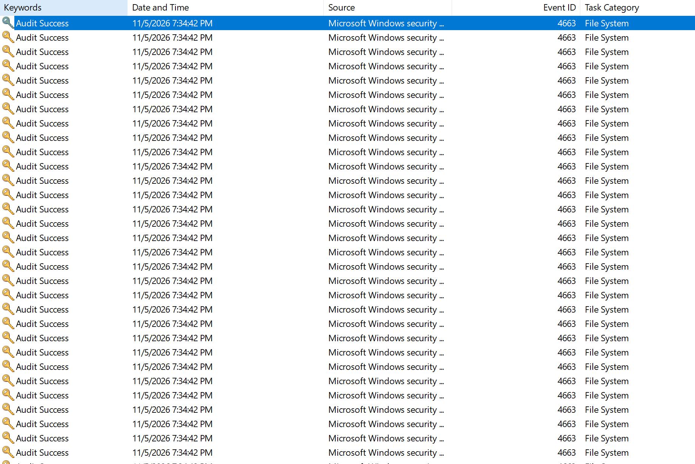

Procmon в момент атаки:

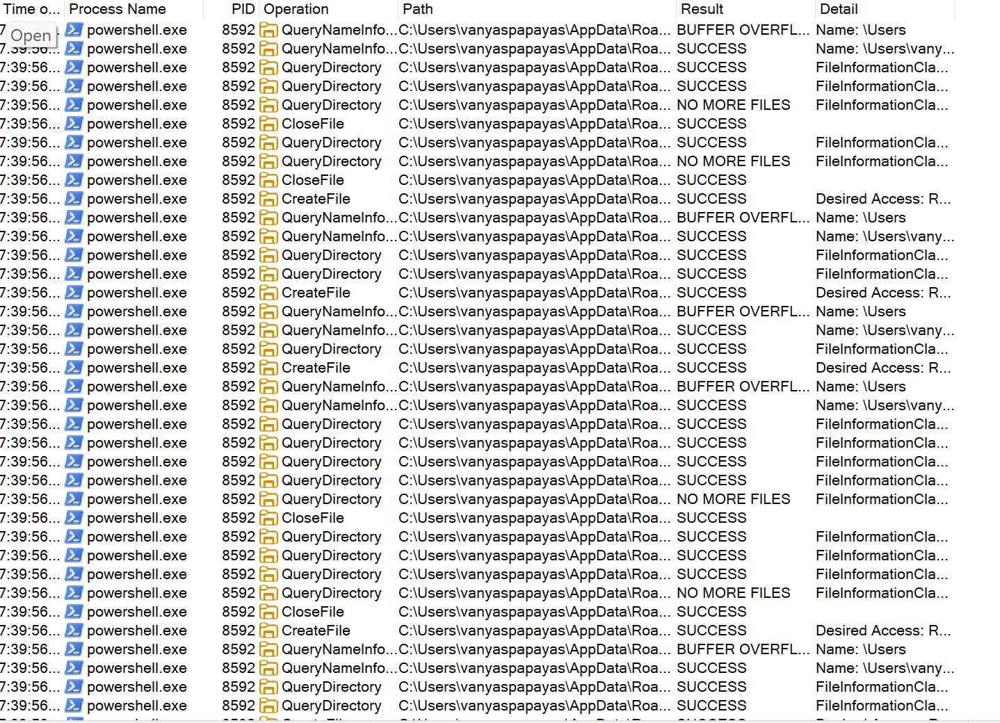

#### II. Рекурсивный поиск почтовых файлов
Скрипт по мотивам Carbanak:
```powershell
$start   = Get-Date
$stage   = "$env:TEMP\stage"
$archive = "$env:TEMP\mail_dump.zip"

$files = Get-ChildItem "$env:APPDATA\Thunderbird\Profiles" -Recurse -File -ErrorAction SilentlyContinue |
    Where-Object { $_.FullName -match '\\(Mail|ImapMail)\\' }

New-Item -ItemType Directory -Path $stage -Force | Out-Null
foreach ($f in $files) {
    Copy-Item $f.FullName -Destination (Join-Path $stage ("{0}_{1}" -f $f.Directory.Name, $f.Name)) -Force
}
Compress-Archive -Path "$stage\*" -DestinationPath $archive -Force
```

Аналогично, Procmon и Audit Logger детектируют эти события. Также в Procmon видно создание `mail_dump.zip`, куда отправляются все письма:

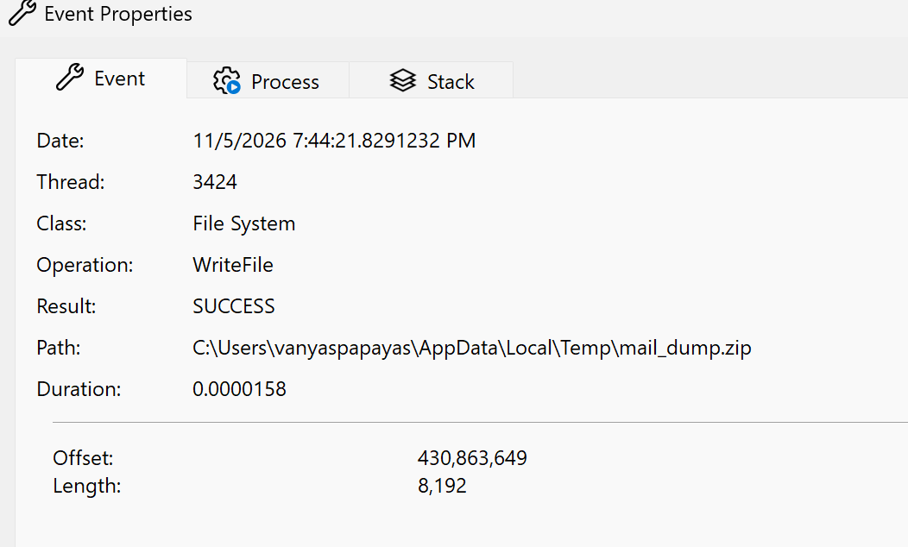

## 2. Настройка сбора событий

### 2.1. Политика аудита и SACL

Подключаю SACL и политику аудита на папку Thunderbird. В папку `%APPDATA%\Thunderbird\Profiles` добавляю следующее правило:

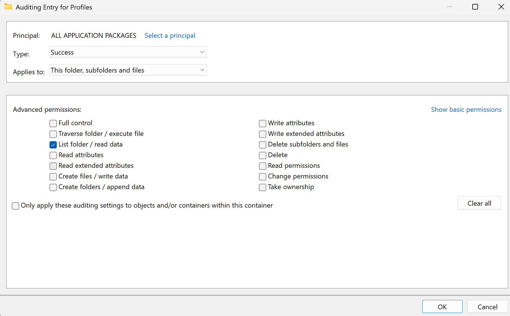

Важно выбирать именно Success, так как получать логи о неудачных попытках открыть файлы будет слишком много шума. Principal: Everyone, так как мы проверяем всех пользователей. Соответственно, Read data это именно то, что нам нужно. Чтение атрибутов тоже создаст лишний шум.

Кодовый эквивалент (скрипт `audit/02_set_sacl_thunderbird.ps1`):
```powershell
$path = "$env:APPDATA\Thunderbird\Profiles"
$acl = Get-Acl -Path $path -Audit

$rule = New-Object System.Security.AccessControl.FileSystemAuditRule(
    "Everyone",
    "ReadData",
    "ContainerInherit, ObjectInherit",
    "None",
    "Success"
)

$acl.AddAuditRule($rule)
Set-Acl -Path $path -AclObject $acl
```

Так SACL будет проверять чтение файлов и листинг папки.

Включение подкатегории аудита (скрипт `audit/01_enable_audit_policy.ps1`), GUID вместо имён, чтобы работало на любой локали:
```
auditpol /set /subcategory:"{0CCE921D-69AE-11D9-BED3-505054503030}" /success:enable
```

Проверка правил аудита:

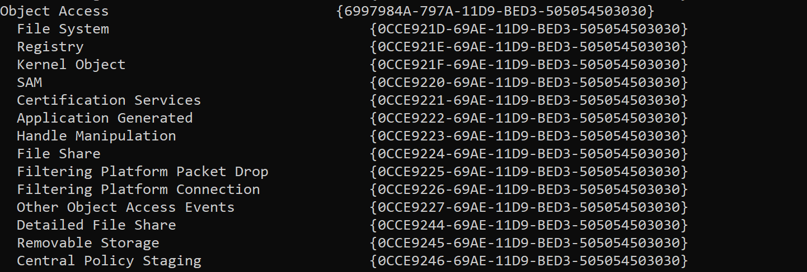

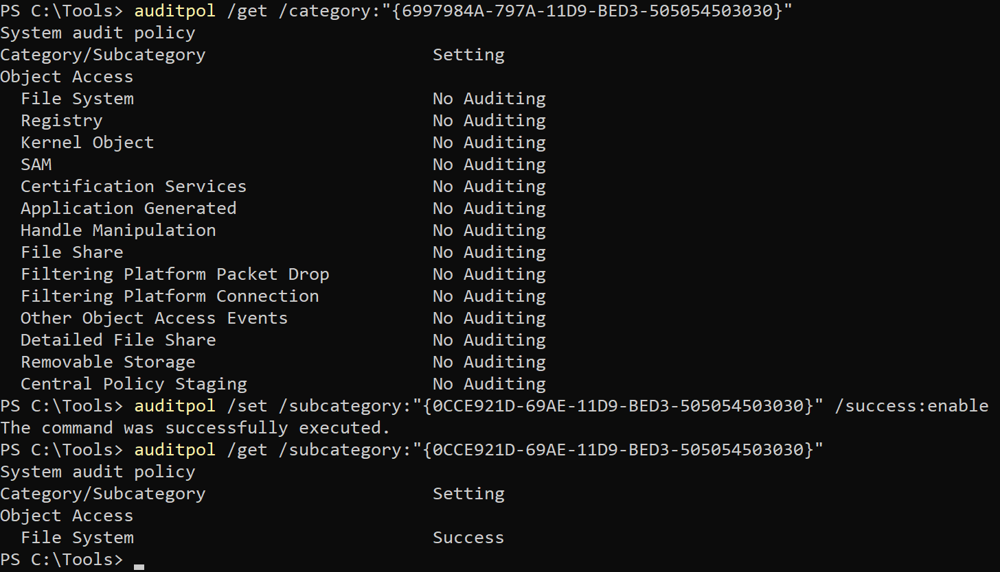

Должно работать, нужно проверить логи в Windows Auditing. Лог под Event ID 4663 создан:

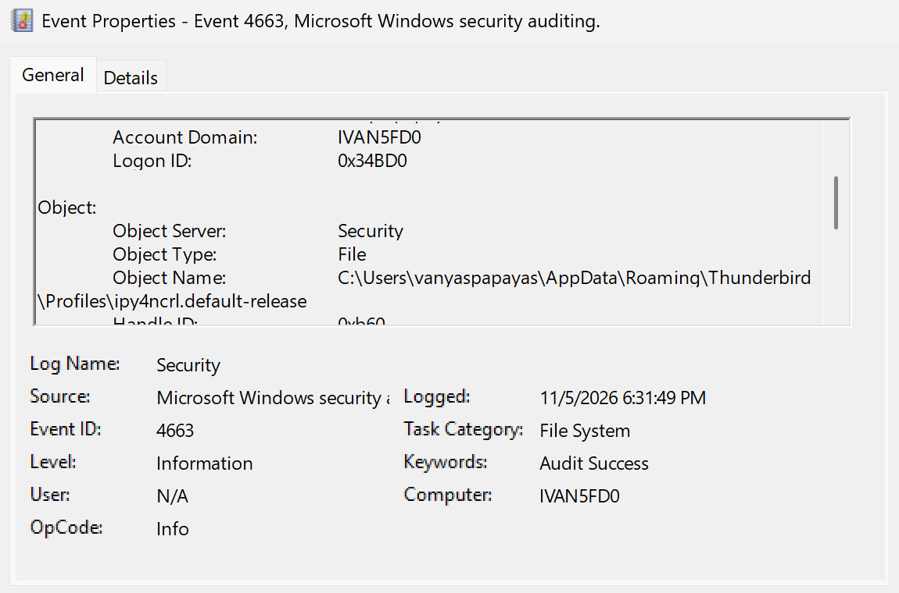

> Примечание. Для реальной инфраструктуры логичнее будет использовать GPO. Но в рамках учебного стенда я решил ограничиться auditpol. GPO-эквивалент приведён комментарием в `audit/01_enable_audit_policy.ps1`.

### 2.2. Аудит доступа к объектам

Проверка, что SACL действительно работает (`Get-Acl -Audit`):

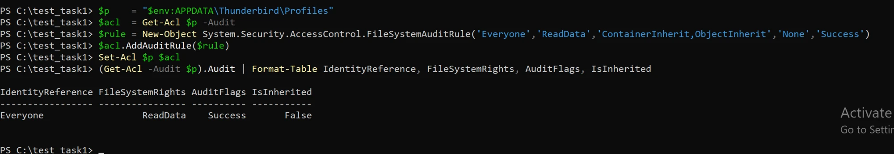

Измерения шума:

| Состояние машины        | Событий 4663 в час | Источник          |
| ----------------------- | ------------------ | ----------------- |
| Простой                 | 58                 | `thunderbird.exe` |
| Активная работа в почте | 150                | `thunderbird.exe` |

58 событий это сам Thunderbird, который в простое опрашивает свои служебные базы (SQLite расширений в профиле).

150 это оценка: за 2 минуты активного пользования я вызвал около 5 событий, 5 x 30 = 150. Оценка примерная.

Как снизить шум:
- SACL только на `read data`.
- Сузить область аудита до хранилищ `Mail` и `ImapMail` вместо всего профиля.
- SACL только на файлы, без наследования на папки, убрал бы события `ListDirectory`. Но тогда теряется сигнал о перечислении каталогов.

### 2.3. Sysmon

Sysmon не логирует чтение файла. Но может дополнять то, что не видит базовый аудит безопасности (контекст по запуску процесса, создание архива, ...).

За основу взят конфиг SwiftOnSecurity. Доработки конфига:
1. FileCreate: добавлено логирование создания `.zip`.
2. ProcessCreate: убрано исключение `powershell.exe`.

Diff (`Compare-Object`):

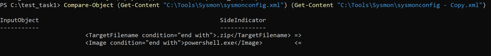

Подробнее о правках и сам конфиг смотри в `sysmon/`.

### 2.4. Procmon

Вначале, когда я только настраивал систему SACL, по ошибке поставил `ALL APPLICATION PACKAGES`. В Windows Audit не было логов об открытии файла, а в Procmon были. Procmon был полезен в этом случае, чтобы увидеть, что я где-то совершил ошибку в настройке SACL или аудита.

## 3. Забрать события со стенда

### 3.1. Выгрузка журналов и подготовка окружения

Я выгрузил 6 журналов:

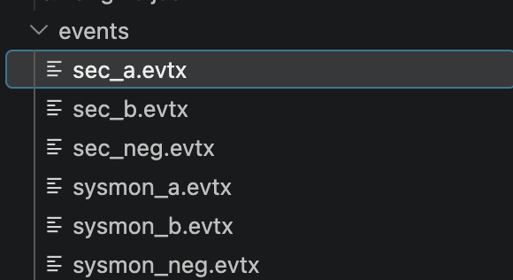

Для каждой из 2 атак были отдельно записаны Windows > Security и Sysmon логи. Также были записаны логи для легитимного использования почтового клиента (негативный тест).

После длительных и продолжительных усилий у меня получилось поставить окружение xp)

### 3.2. Нормализация событий

На каждый сценарий я выгружал отдельный файл:

| Сценарий               | Security      | Sysmon          |
| ---------------------- | ------------- | --------------- |
| атака `cmd /c copy`    | `sec_a.evtx`  | `sysmon_a.evtx` |
| массовый сбор          | `sec_b.evtx`  | `sysmon_b.evtx` |
| легитимный Thunderbird | `sec_neg.evtx`| `sysmon_neg.evtx` |

Нормализация в расширении vscode-xp (Normalize Events from Files). Результаты по файлам: sec_a 76/96 (20 событий не 4663 и не нормализуются открытым набором правил, для правила они не нужны), sec_b 192/192, sec_neg 88/88, sysmon_a 1/1, sysmon_b 3/3, sysmon_neg 3/3. Все события 4663, на которых работает правило, нормализуются полностью.

В результате для каждого теста был собран отдельный файл `raw_events_*` (события я отбирал по EventRecordID из нормализованных выгрузок, руками ничего не писал):

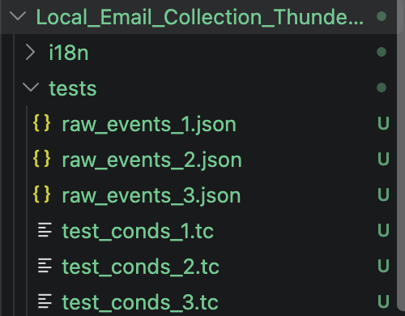

### 3.3. Правило корреляции

Чтобы разобраться в синтаксисе и в том, что нам стоит указывать для определения инцидента, я пользовался помощью ИИ. Правило лежит в `rule/Local_Email_Collection_Thunderbird/`.

```
event Mail_Store_Read:
    key:
        event_src.host, subject.process.id
    filter {
        filter::NotFromCorrelator()
        and event_src.title == "windows"
        and msgid == "4663"
        and object.type == "file"
        and datafield5 == "0x1"
        and regex(object.fullpath, "\\\\appdata\\\\roaming\\\\thunderbird\\\\profiles\\\\[^\\\\]+\\\\(mail|imapmail)\\\\", 0) != null
        and subject.process.fullpath != null
        and regex(lower(subject.process.fullpath), "^c:\\\\program files( \\(x86\\))?\\\\mozilla thunderbird\\\\", 0) == null
        and not in_list([
                "c:\\windows\\system32\\searchprotocolhost.exe",
                "c:\\windows\\system32\\searchindexer.exe",
                "c:\\windows\\system32\\searchfilterhost.exe"
            ], lower(subject.process.fullpath))
        and regex(lower(subject.process.fullpath), "^c:\\\\programdata\\\\microsoft\\\\windows defender\\\\platform\\\\[^\\\\]+\\\\(msmpeng|mpdefendercoreservice)\\.exe$", 0) == null
    }

rule Local_Email_Collection_Thunderbird: Mail_Store_Read

    init {
        $labels = "w_auto"
    }

    on Mail_Store_Read {
        $event_src.ip = event_src.ip
        $event_src.hostname = event_src.hostname
        $event_src.fqdn = event_src.fqdn
        $event_src.host = event_src.host
        $event_src.asset = event_src.asset
        $event_src.title = event_src.title
        $event_src.subsys = event_src.subsys
        $event_src.vendor = event_src.vendor
        $event_src.category = event_src.category
        $event_src.rule = event_src.rule

        $object.name = object.name
        $object.path = object.path
        $object.fullpath = object.fullpath
        $object.type = object.type
        $object.property = object.property
        $object.value = object.value

        $subject.account.name = subject.account.name
        $subject.account.domain = subject.account.domain
        $subject.account.session_id = subject.account.session_id
        $subject.account.id = subject.account.id
        $subject.account.privileges = subject.account.privileges

        $subject.process.id = subject.process.id
        $subject.process.name = subject.process.name
        $subject.process.path = subject.process.path
        $subject.process.fullpath = subject.process.fullpath

        $alert.key = subject.process.fullpath
        $alert.context = subject.account.domain + "\\" + subject.account.name + " read mail store '" + object.fullpath + "' with " + subject.process.fullpath + " on " + event_src.hostname
    }

emit {
    $subject = "account"
    $action = "read"
    $object = "file"
    $status = "success"

    $correlation_type = "incident"
    $importance = "medium"

    $category.generic = "Attack"
    $category.high = "Collection"
    $category.low = "Email Collection"
}
```

**Правило срабатывает на чтение файла почтового хранилища Thunderbird любым процессом, кроме самого Thunderbird и доверенных системных служб.**

Правило работает на событии `Mail_Store_Read`, где каждое событие 4663 дает алерт. Основное по правилу:
- Корреляционные события игнорируются.
- Проверяется только ReadData по файловой системе.
- Проверяется только каталог хранилища Thunderbird (`Mail` / `ImapMail`).
- Игнорируются доверенные процессы (`thunderbird.exe`, Windows Search, Defender). При этом `System32` целиком НЕ исключается: `cmd.exe` и `powershell.exe` лежат там, и исключение всего каталога пропустило бы обе атаки.

Алерт содержит `subject=account, action=read, object=file, status=success`, `correlation_type=incident`, `importance=medium`, категория Attack / Collection / Email Collection.

### 3.4. Тесты

Все тесты собраны из нормализованных логов со стенда (`rule/.../tests/`), руками события не писались.

1. **Копирование INBOX через `cmd /c copy`.** Правило дало 5 срабатываний. Два на чтение самого файла `inbox`, остальные три на обращение к папке `imap.gmail.com` (листинг каталога, у него та же маска `0x1`, что и у чтения файла; на стенде SACL наследуется на папки). На событие Sysmon с этой командой правило не реагирует, потому что смотрит только 4663.
2. **Массовый сбор через PowerShell.** 7 срабатываний: читались файлы и из `ImapMail`, и из `Mail`, и сами письма (`inbox`), и индексы `.msf`. Создание архива `mail_dump.zip` правило не ловит, но это уже другой этап атаки.
3. **Обычная работа в Thunderbird.** 0 срабатываний. Хотя Thunderbird за минуту работы прочитал почти 80 тех же почтовых файлов, что и атакующий, их гасит белый список по полному пути процесса. Это главный негативный тест: он проверяет сам белый список, а не то, что события не дошли.

## 6. Рефлексия

**Как обойти правило.**
Правило доверяет любому процессу из `C:\Program Files\Mozilla Thunderbird\`. Значит, если выполнить код внутри самого `thunderbird.exe` (через инъекцию, вредоносное расширение, штатный экспорт писем), чтение будет выглядеть легитимно. Ещё варианты: положить свой exe в папку Thunderbird (нужен админ), читать файлы с теневой копии (VSS, другой путь), снять SACL (нужен админ, видно по 4907), использовать профиль не из стандартного места (параметр `-profile`, portable).

Что закрыто: переименование своего exe в `thunderbird.exe` (проверяется полный путь, а не имя), использование штатных `cmd` / `powershell` из `System32` (не исключал их специально), обфускация пути в командной строке (в 4663 полный путь вычисляет ядро).

**Что бы сделал за неделю.**
Попытался бы закрыть обход, описанный выше: сузить белый список до конкретного `thunderbird.exe` по полному пути, детектировать File Create в папке Thunderbird (подмену оригинального `thunderbird.exe`), проверять подпись или хеш. Ещё: агрегация массового сбора в один алерт вместо десятков, связка 4663 с Sysmon 1 / 4688 по PID (командная строка и родитель в алерте), поддержка Outlook (`.pst` / `.ost`), табличный список вместо хардкода.
